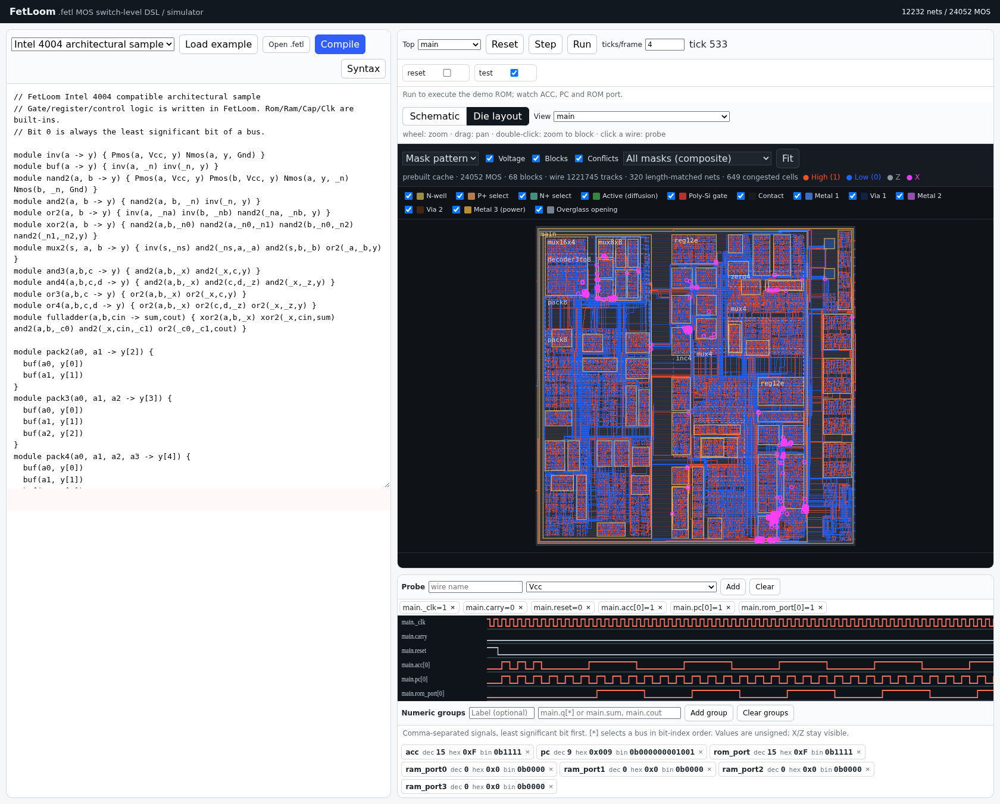

# FetLoom

A browser-based MOS switch-level circuit simulator. Write circuits in `.fetl` and combine modules to build anything from an inverter to a CPU.

[Open FetLoom](https://reki2000.github.io/fetloom/)

## Try an example

Selecting an example automatically compiles it and installs recommended waveform probes and numeric groups. Counter and CPU examples are initialized automatically: press **Run** to watch the demo. Each example has a hint below its inputs.

**Step** advances one tick, **Run / Pause** toggles continuous execution, and **Reset** initializes the circuit and reapplies the example defaults. After editing the source, press **Compile**. Use **Syntax** at the top right of the editor to show the .fetl grammar guide in the right pane; **Back to simulation** restores the circuit and probes.

Examples include an inverter, NAND/AND gates, full adder, latch, ROM/RAM, 4-bit counter, ALU, register file, TD4, and Intel 4004. CPU demo ROMs are included.

Intel 4004 in **Die layout**, after 500 steps following initialization (tick 533). High wires are red and Low wires are blue.



## Probes and views

Click a wire or add a signal through **Probe** to see its waveform.

**Numeric groups** show unsigned **dec / hex / bin** values together on one line, independently of waveforms. Enter a bus such as `main.q[*]` or signals such as `main.sum, main.cout`, then click **Add group**. List signals least significant bit first; `[*]` expands a bus in bit-index order. Binary preserves individual X/Z bits; decimal and hex show X/Z for unknown values. Hover over a group to see its member signals.

**Schematic** shows the circuit hierarchy. **Die layout** shows chip placement and routing, with mask and schematic drawing modes. **Voltage** is enabled by default: High is red, Low blue, Z grey, and X magenta. Use the wheel to zoom, drag to pan, and double-click a block to zoom into it.

## Write a circuit

```fetl
module inv(a -> y) {
  Pmos(a, Vcc, y)
  Nmos(a, y, Gnd)
}

module main(a -> y) {
  inv(a, y)
}
```

Built-in elements are `Nmos`, `Pmos`, `Vcc`, `Gnd`, `Cap`, `Clk`, `Rom`, and `Ram`. See the [language specification](documentation/SPEC.md) and [references](documentation/REFERENCES.md).

## Development

From the repository root:

```bash
python3 -m http.server 8000
```

Open [localhost:8000](http://localhost:8000/). No package installation is needed; the WASM core is already built. Use HTTP rather than opening the HTML file directly so the browser can load WASM and ROM files. Stop the server with `Ctrl+C`.

Tests require Node.js; rebuilding WASM requires clang.

```bash
npm test

# Build the static site in docs/
npm run build

# Rebuild WASM
(cd wasm && ./build.sh)

# Update stale layout caches
npm run layouts
# Rebuild all layouts
npm run layouts -- --force
# Rebuild one example
npm run layouts -- td4
```

Large layouts take time to generate, so examples use prebuilt caches. Edited circuits are laid out in a Web Worker and cached in IndexedDB. Tests also check that prebuilt caches match their source files.

`src/` contains the UI, parser, simulator, and drawing code; `wasm/` the C core; `examples/` the samples; `layouts/` the drawing caches; `documentation/` the guides and screenshots; and `tests/` the tests.

## Scope

FetLoom models 0/1/X/Z connectivity for educational switch-level simulation. It does not model analog voltages or propagation delays. The 4004 sample targets architectural and instruction behavior, rather than reproducing the original chip's pin cycles or transistor layout.
